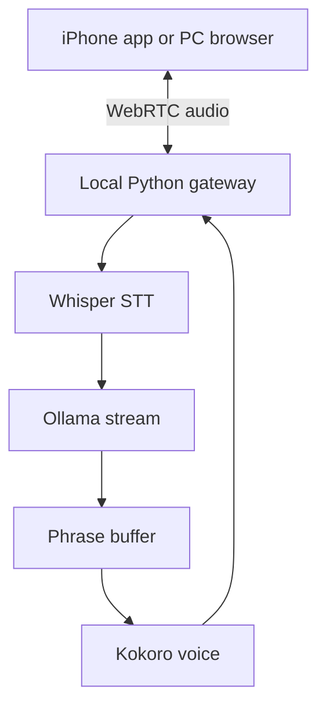

# AURA Local Voice architecture

- `local_server/audio.py`: 16 kHz microphone capture, 20 ms VAD, 48 kHz WebRTC playback, interruption queue.
- `local_server/personality.py`: independent personality and speech style. No tools.
- `local_server/phrases.py`: streamed tokens into speakable clauses rather than individually generated word audio.
- `local_server/inference.py`: swappable Whisper, Ollama and Kokoro implementations.
- `local_server/session.py`: cancellation-safe per-connection conversation state and transcript events; history in RAM.
- `local_server/app.py`: local paired WebRTC signaling endpoint.
- `web/`: free desktop interface for immediate use.
- `App.tsx` and `src/realtime.ts`: iPhone user interface and native WebRTC connection.
- `.github/workflows/build-unsigned-ipa.yml`: compiles iOS device code on a macOS runner without code signing and packages the unsigned app.

Design tradeoffs: local latency is primarily STT time + Ollama token speed + first Kokoro phrase synthesis. Keeping everything local avoids service fees but does not guarantee cloud-style real-time speech quality. VAD and output playback run continuously in short frames while the heavy models are loaded on demand. Fast and Soft listening modes trade off pause detection and false starts. The person can interrupt playback; current in-flight TTS may briefly continue consuming CPU after cancellation, though it won't be queued for playback.

